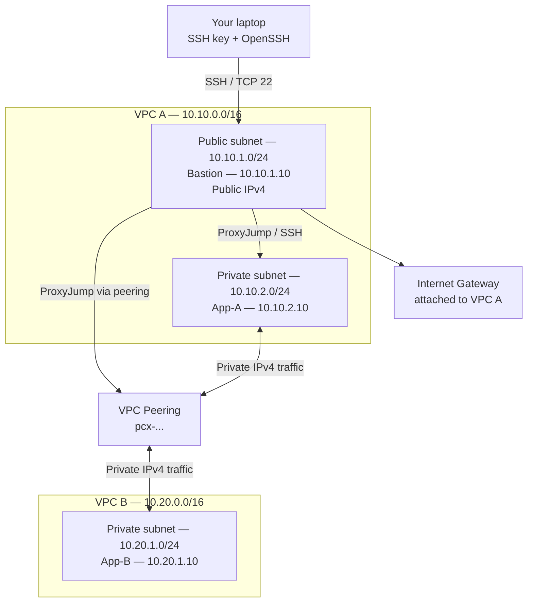

# AWS VPC Peering Lab — Private Connectivity Between Two VPCs

A hands-on AWS networking project that connects two non-overlapping VPCs using **VPC Peering**. The lab uses three EC2 instances: one public bastion host and two private application hosts.

> **Source:** Built from the EWB Cloud Labs *AWS VPC Peering Student Project Workbook* (Project 01, October 2026). This repository is a practical companion; record your own AWS resource IDs, screenshots, and test output. Expected results are not proof that the lab has been executed.

## Project goals

- Design two VPCs with non-overlapping IPv4 CIDRs.
- Create public and private subnets with explicit route-table associations.
- Keep both application instances private (no public IPv4 addresses).
- Establish VPC peering and configure routes in both directions.
- Administer private instances through a bastion host using SSH `ProxyJump`.
- Demonstrate baseline failure, successful private connectivity, and a controlled security-group failure/recovery.

## Architecture



**Traffic paths**

- Administration: `Laptop → Bastion → App-A` or `Laptop → Bastion → App-B`.
- Workload connectivity: `App-A ↔ App-B` using private IPv4 addresses over the peering connection.
- VPC B does **not** receive internet access through VPC A's internet gateway. VPC peering is non-transitive.

## Address plan

| Resource | VPC / subnet | IPv4 CIDR or address |
|---|---|---:|
| `ewb-vpc-a` | VPC A | `10.10.0.0/16` |
| `ewb-a-public` | VPC A public subnet | `10.10.1.0/24` |
| `ewb-a-private` | VPC A private subnet | `10.10.2.0/24` |
| `ewb-vpc-b` | VPC B | `10.20.0.0/16` |
| `ewb-b-private` | VPC B private subnet | `10.20.1.0/24` |
| `ewb-bastion` | `ewb-a-public` | `10.10.1.10` + public IPv4 |
| `ewb-app-a` | `ewb-a-private` | `10.10.2.10`, no public IPv4 |
| `ewb-app-b` | `ewb-b-private` | `10.20.1.10`, no public IPv4 |

The VPC CIDRs do not overlap. If you use AWS-assigned instance addresses instead of the listed addresses, update every command and host-specific `/32` rule accordingly.

## Resource names

- Internet gateway: `ewb-igw-a`
- Route tables: `ewb-rt-a-public`, `ewb-rt-a-private`, `ewb-rt-b-private`
- Security groups: `ewb-sg-bastion`, `ewb-sg-app-a`, `ewb-sg-app-b`
- Peering connection: `ewb-a-b-peer`
- EC2 key pair: `ewb-lab`

Tag created resources with `Project=EWB-VPC-Peering` and `Student=<your-name>`.

## Prerequisites

- An AWS lab account permitted to manage VPC, EC2, and key pairs.
- One AWS Region for all resources (the workbook gives Mumbai, `ap-south-1`, as an example).
- AWS Console access; AWS CLI is optional for the CLI reference.
- Amazon Linux 2023 instances and a local OpenSSH client. Windows users can use WSL.
- Basic familiarity with CIDR notation, route tables, security groups, and SSH.

## Build sequence

1. Read [the architecture and IP plan](docs/architecture-and-ip-plan.md).
2. Create VPC A, its public/private subnets, internet gateway, and route tables.
3. Create VPC B and its private subnet/route table.
4. Configure the security groups in [the security guide](docs/security-groups.md).
5. Launch the three EC2 instances using [the compute guide](docs/compute-and-ssh.md).
6. Confirm bastion and App-A SSH access. Capture the baseline ping failure before peering.
7. Create and accept the peering connection.
8. Add all three peering routes as shown in [the routing guide](docs/routing-and-validation.md).
9. Run the positive and controlled-negative tests.
10. Save evidence and clean up all lab resources.

Detailed console steps are in the original workbook. This repository reorganizes the key build and validation information into GitHub-friendly documentation.

## Route-table summary

| Route table | Destination | Target |
|---|---|---|
| `ewb-rt-a-public` | `10.10.0.0/16` | `local` (AWS-created) |
| `ewb-rt-a-public` | `0.0.0.0/0` | `ewb-igw-a` |
| `ewb-rt-a-public` | `10.20.0.0/16` | VPC peering connection |
| `ewb-rt-a-private` | `10.10.0.0/16` | `local` (AWS-created) |
| `ewb-rt-a-private` | `10.20.0.0/16` | VPC peering connection |
| `ewb-rt-b-private` | `10.20.0.0/16` | `local` (AWS-created) |
| `ewb-rt-b-private` | `10.10.0.0/16` | VPC peering connection |

The public subnet needs the peering route because the bastion opens its own SSH connection to App-B. The private route tables need routes in both directions so replies can return.

## Security-group intent

| Security group | Inbound | Source |
|---|---|---|
| `ewb-sg-bastion` | SSH / TCP 22 | Your current public IPv4 `/32` |
| `ewb-sg-app-a` | SSH / TCP 22 | `10.10.1.10/32` |
| `ewb-sg-app-a` | ICMPv4 Echo request | `10.20.1.10/32` |
| `ewb-sg-app-b` | SSH / TCP 22 | `10.10.1.10/32` |
| `ewb-sg-app-b` | ICMPv4 Echo request | `10.10.2.10/32` |

For ICMP Echo request, use type `8`, code `0` if the console requests them. Keep the default allow-all outbound rules and default network ACLs for this beginner lab. Do not expose SSH or ICMP to `0.0.0.0/0`.

## Connect using SSH ProxyJump

Store the downloaded key locally as `~/.ssh/ewb-lab.pem` and restrict its permissions:

```bash
chmod 400 ~/.ssh/ewb-lab.pem
```

Add this to `~/.ssh/config`, replacing `BASTION_PUBLIC_IP` with the current public IPv4 address of the bastion:

```sshconfig
Host ewb-bastion
    HostName BASTION_PUBLIC_IP
    User ec2-user
    IdentityFile ~/.ssh/ewb-lab.pem
    IdentitiesOnly yes

Host ewb-app-a
    HostName 10.10.2.10
    User ec2-user
    IdentityFile ~/.ssh/ewb-lab.pem
    IdentitiesOnly yes
    ProxyJump ewb-bastion

Host ewb-app-b
    HostName 10.20.1.10
    User ec2-user
    IdentityFile ~/.ssh/ewb-lab.pem
    IdentitiesOnly yes
    ProxyJump ewb-bastion
```

Test in order:

```bash
ssh ewb-bastion
ssh ewb-app-a
ssh ewb-app-b
```

Run these commands on your laptop. Do not copy the private key onto an EC2 instance.

## Validation checklist

| Test | Command / action | Expected acceptance result |
|---|---|---|
| Baseline, before peering | On App-A: `ping -c 4 10.20.1.10` | No replies |
| Forward path, after routes | On App-A: `ping -c 4 10.20.1.10` | 4 replies, 0% packet loss |
| Reverse path, after routes | On App-B: `ping -c 4 10.10.2.10` | 4 replies, 0% packet loss |
| Private SSH | Laptop: `ssh ewb-app-b` | Shell on App-B through bastion |
| Isolation | Inspect EC2 instance details | App-A and App-B have no public IPv4 |
| Controlled failure | Remove App-B inbound ICMP Echo request from `10.10.2.10/32`, then repeat forward ping | Replies stop; restore rule and replies resume |

These are expected results from the workbook, not results generated by this repository. Record your actual terminal output.

## Repository layout

```text
.
├── README.md
├── LICENSE-NOTICE.md
├── .gitignore
├── docs/
│   ├── architecture-and-ip-plan.md
│   ├── network-build.md
│   ├── security-groups.md
│   ├── compute-and-ssh.md
│   ├── routing-and-validation.md
│   ├── troubleshooting.md
│   ├── submission-checklist.md
│   └── cleanup.md
├── scripts/
│   ├── verify-connectivity.sh
│   └── aws-cli-reference.sh
└── evidence/
    └── README.md
```

## Cost and cleanup warning

EC2, EBS, and public IPv4 usage can incur charges. Check current pricing and account credits before launching. This lab does not require a NAT gateway. After saving evidence, follow [the cleanup guide](docs/cleanup.md) and check Billing for remaining resources; usage reporting can lag.

## Learning outcomes

By completing this lab, you should be able to explain:

1. Why VPC CIDR ranges must not overlap for this peering design.
2. Why both sides need routes to the other VPC CIDR.
3. Why App-B sees the bastion's private IP as the SSH source.
4. Why an Active peering connection alone does not guarantee connectivity.
5. Why VPC peering is non-transitive and does not share internet gateway access.

## Author / student details

Update these before publishing:

- **Student:** Your Name
- **Batch:** Your Batch
- **AWS Region:** `ap-south-1` (or the Region you used)
- **Completion date:** YYYY-MM-DD

---

**EWB Cloud Labs — Learn. Elevate. Empower.**  
Project workbook: *AWS VPC Peering Student Project*, Project 01 / October 2026.
